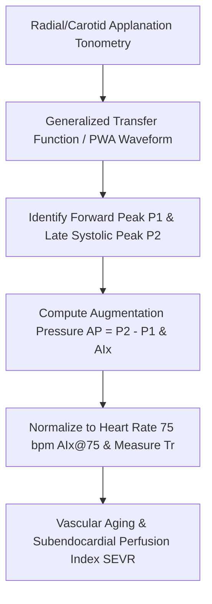

# Cardiac Central Aortic Augmentation Index (AIx) & Pulse Wave Analysis (PWA) Skill

[](LICENSE)
[](https://www.python.org/)
[](https://modelcontextprotocol.io/)
[](requirements.txt)
[](https://github.com/alphaparkinc)

A zero-dependency, mathematically rigorous personal agent skill that evaluates central aortic pulse wave reflections, arterial wall elasticity, and late-systolic cardiac afterload via applanation tonometry pulse wave analysis.

## Architecture



## Quick Start

```python
from client import CentralAorticAugmentationIndexClient

client = CentralAorticAugmentationIndexClient()
result = client.evaluate_pwa(
    aortic_systolic_bp_mmhg=115.0,
    aortic_diastolic_bp_mmhg=75.0,
    inflection_pressure_mmhg=105.0,
    reflection_time_tr_ms=140.0,
    heart_rate_bpm=72.0
)
print("Augmentation Index AIx@75 (%):", result["wave_reflection_kinetics"]["aix_normalized_at_75bpm_pct"])
print("SEVR (%):", result["myocardial_perfusion"]["subendocardial_viability_ratio_sevr_pct"])
print("Stiffness Class:", result["vascular_stiffness_assessment"]["stiffness_classification"])
```

## License
Apache-2.0
